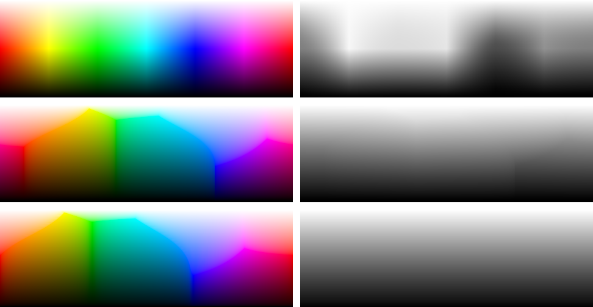

# HSL, Okhsl and HSL*

HSL* compared with the two spaces it sits between. Classic HSL is what most tools offer, and HSL* keeps its interface. [Okhsl](https://bottosson.github.io/posts/colorpicker/) by Björn Ottosson builds hue and saturation in OKLab, and HSL*'s saturation correction is fitted against it. How HSL* works is in the [README](README.md), and so is a comparison of the three approaches in words, with HSLuv as well.

Each space is used with its own coordinates, a hue in degrees and a saturation and lightness from 0 to 1 (for HSL*, L* / 100). Where the spaces are compared at the same hue, it's the hue of the same pure color, so the rows of red start from the same red in all three. Okhsl is a port of Ottosson's reference implementation (MIT licence). All figures and numbers come from [scripts/comparison.js](scripts/comparison.js), and `npm run compare` makes them again.

## Rows from black to white

Each row runs from lightness 0 to 1 at full saturation. In HSL the pure color always sits in the middle, so the rows of yellow and cyan are already light halfway through and the row of blue is still dark. Light blues turn violet and light reds turn pink. Okhsl and HSL* both put the pure color at its own lightness, and their tints keep its hue, so their rows look much alike. The difference is in the details. Okhsl's lightness only comes close to L\*, and HSL*'s light blues still drift by a few degrees (see [the hue of tints](#the-hue-of-tints-and-shades)).

## Lightness

From top to bottom HSL, Okhsl and HSL*, each at full saturation, with hue across and white at the top. On the right, the same plane in grey, the luminance of each color. A space whose rows have equal lightness turns into a plain gradient from black to white.

The CIE L\* that a row of equal lightness spans over the hue circle, at full saturation:

| Lightness | HSL | Okhsl | HSL* |
|---|---:|---:|---:|
| 0.1 | 2.2–20.3 | 5.7–8.1 | 10.0 |
| 0.3 | 17.0–61.3 | 26.0–31.0 | 30.0 |
| 0.5 | 32.3–97.1 | 45.3–52.1 | 50.0 |
| 0.7 | 51.3–97.5 | 66.0–72.8 | 70.0 |
| 0.9 | 83.6–98.9 | 89.0–92.1 | 90.0 |

HSL\*'s rows are exact by construction. Okhsl's are within a few L\*, which is close enough to look even. HSL's span most of the scale.

## Contrast

Twelve hues at lightness 0.5 and full saturation, each with its WCAG 2 contrast ratio against white, written in white.

| | HSL | Okhsl | HSL* |
|---|---:|---:|---:|
| Lowest | 1.16 | 4.18 | 4.48 |
| Highest | 8.42 | 5.21 | 4.48 |

The contrast ratio depends only on luminance, and in HSL\* luminance depends only on L\*. So every hue and every saturation at the same L\* has the same contrast against white, black or any grey, and the lightness for a target contrast can be worked out once. At L\* 49.9 or below, every HSL\* color has at least 4.5 : 1 against white, the WCAG AA level for text. In Okhsl the ratio still varies by about a quarter between hues, in HSL by a factor of seven.

## Hue spacing

How different neighbouring hues look, as the CIEDE2000 color difference between hues 10° apart on each space's own hue axis, at lightness 0.5. Each bar is drawn in the color halfway between the two. The more even the bars, the more equal steps of hue look equal.

How much the steps vary (standard deviation over mean), with the smallest and largest step:

| | HSL | Okhsl | HSL* |
|---|---:|---:|---:|
| s 1, lightness 0.3 | 56 % (0.7–13.6) | 43 % (2.2–14.0) | 44 % (2.2–14.7) |
| s 1, lightness 0.5 | 59 % (0.6–16.2) | 27 % (3.7–11.7) | 28 % (4.0–12.5) |
| s 1, lightness 0.7 | 41 % (2.0–10.8) | 16 % (4.6–8.6) | 16 % (3.6–8.7) |
| s 0.5, lightness 0.3 | 41 % (1.5–8.2) | 13 % (2.5–4.0) | 24 % (1.7–4.8) |
| s 0.5, lightness 0.5 | 42 % (1.7–10.3) | 11 % (3.2–4.8) | 20 % (2.1–5.2) |
| s 0.5, lightness 0.7 | 38 % (1.9–7.4) | 8 % (3.2–4.3) | 13 % (2.1–4.3) |

At full saturation HSL\* is about as even as Okhsl, and both are far more even than HSL, whose steps between yellow and green and around blue nearly vanish. There the gamut sets the limits for both. At lower saturation Okhsl is clearly more even. Its saturation is a share of chroma, so all hues at s 0.5 are about equally colorful, and only the hue changes from bar to bar. HSL\*'s saturation is a share of the gamut, toned down near grey for the most colorful hues, so neighbouring hues can still differ in colorfulness, and that adds to the steps.

## The hue of tints and shades

How far the OKLab hue of tints, shades and lower saturations moves away from the pure color's, the largest difference along the row from black to white at saturations 0.25 to 1, in degrees. Colors too close to grey to have a hue (OKLab chroma below 0.02) are left out.

| Hue | HSL | Okhsl | HSL* |
|---|---:|---:|---:|
| Red | −11.7 | 0.0 | −0.5 |
| Yellow | −2.9 | 0.0 | 1.6 |
| Green | 2.2 | 0.0 | −1.1 |
| Cyan | 2.2 | 0.0 | −0.6 |
| Blue | 22.6 | 0.0 | 3.4 |
| Magenta | −2.4 | 0.0 | 0.0 |

Okhsl keeps the OKLab hue by definition. HSL\*'s hue shift keeps it within about 1.5°, and within 3.5° in the blues, where it's held back so that the conversion stays exactly invertible. HSL moves light blues by more than 20° towards violet and light reds by 12° towards pink.

## Limits

The hue circle at full saturation, at lightness 0.4 and 0.9, with the pure colors lined up. At the same lightness, not every hue can be equally colorful in sRGB. At 0.9 the gamut reaches far out only around yellow and cyan, so at full saturation these stand out against pale reds, blues and magentas. At 0.4 it's the other way round, with strong blues, reds and magentas next to olive yellows and dull greens.

Okhsl shows the same, because its full saturation is also the edge of the gamut. Both trade evenness at full saturation for reaching every color sRGB has. HSL hides it at 0.9 by mixing every hue with the same share of white, which makes its yellows almost white and its blues much darker than them (L\* 98.9 against 83.6). HSL\*'s saturation correction evens out colorfulness near grey, but it never boosts the weak hues and doesn't change full saturation. For colors of about equal colorfulness across hues, stay well below full saturation. More on this in the README's [limitations](README.md#limitations).

## Round trip and speed

From gamma-encoded sRGB to the space and back, over 20,000 random colors. The error is the largest difference in any channel after the round trip. The times are per conversion, in Node 24 on an Apple M5 Max, and vary by about a tenth between runs.

| | Worst channel error | From sRGB | To sRGB |
|---|---:|---:|---:|
| HSL | 1.2·10⁻¹⁵ | 20 ns | 65 ns |
| Okhsl | 1.6·10⁻⁶ | 320 ns | 365 ns |
| HSL* | 2.4·10⁻¹⁴ | 385 ns | 320 ns |

HSL is a few lines of arithmetic. Okhsl and HSL\* take about the same time, Okhsl for finding the edge of the gamut in OKLab, HSL\* for its two corrections. HSL\* undoes itself exactly, up to the rounding of 64-bit floating point. Okhsl's round trip is off by up to about 10⁻⁶, inherited from OKLab, whose two published matrices aren't exact inverses of each other. That's far below an 8-bit step.

## References

- [Björn Ottosson: Okhsv and Okhsl](https://bottosson.github.io/posts/colorpicker/) (2021), HSL-like coordinates on OKLab, with the reference implementation ported here.
- [Gaurav Sharma, Wencheng Wu, Edul N. Dalal: The CIEDE2000 color-difference formula](https://hajim.rochester.edu/ece/sites/gsharma/ciede2000/) (2005), implementation notes and test data, which the implementation here reproduces.
- [W3C: WCAG 2.2](https://www.w3.org/TR/WCAG22/), relative luminance and contrast ratio.
