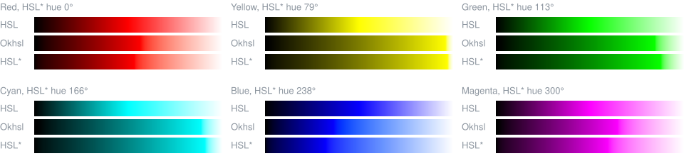
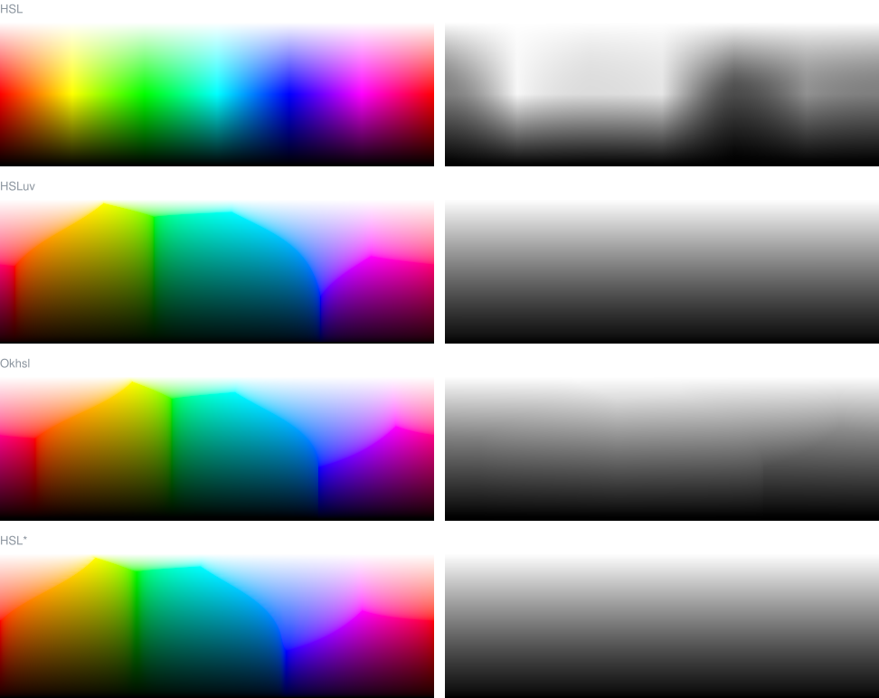
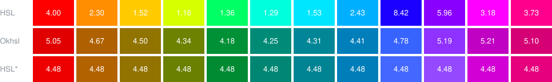
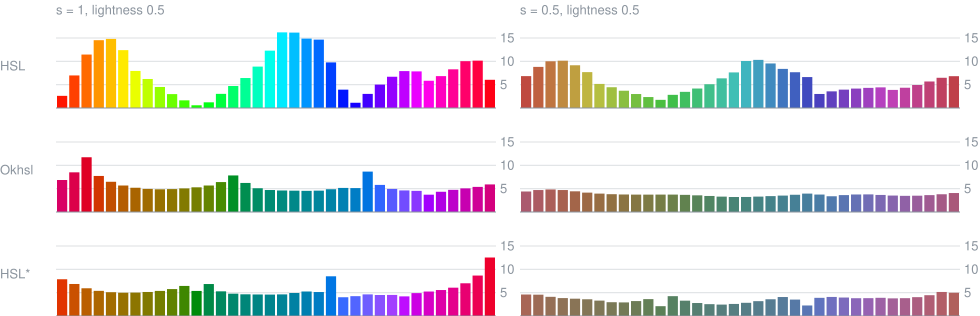
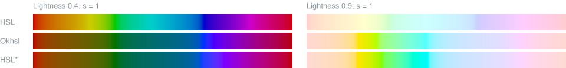

# HSL, HSLuv, Okhsl and HSL*

Classic HSL is what most tools offer, and HSL* keeps its interface. [HSLuv](https://www.hsluv.org/) builds hue and saturation in CIELUV, [Okhsl](https://bottosson.github.io/posts/colorpicker/) in OKLab, and HSL*'s saturation correction is fitted against Okhsl. How HSL* works is in the [README](README.md).

## Approaches

HSLuv, Okhsl and HSL* give an HSL-like interface with perceptually meaningful lightness and saturation limited to the sRGB gamut. They differ in where hue and saturation come from, and how much work the gamut boundary takes.

| | HSL | HSLuv | Okhsl | HSL* |
|---|---|---|---|---|
| Built on | sRGB, gamma-encoded | CIELUV | OKLab | sRGB in linear light |
| Lightness | Mean of the largest and smallest channel | CIE L* | OKLab lightness with a toe function, close to CIE L* | CIE L* |
| Rows of equal lightness | Far from it | Exact | Close | Exact |
| Hue | HSV hue | CIELUV hue angle | OKLab hue | HSV hue, spaced by OKLab |
| Hue of tints and shades | Mixed with white or black in gamma-encoded sRGB | Constant in CIELUV | Constant in OKLab | Kept in OKLab within a few tenths of a degree, up to about 4° in the blues |
| Saturation | Share of the channel range possible at that lightness | CIELUV chroma as a share of the most the gamut allows | Chroma, interpolated through fitted values to behave evenly | Linear mix between grey and the most vivid sRGB color, toned down near grey for the most colorful hues |
| Gamut boundary | Built into the construction | Ray intersected with six lines per lightness | Approximated with fitted functions | Built into the construction |
| Round trip | Exact, up to rounding (about 10⁻¹⁵) | Exact, up to rounding (about 10⁻¹³) | Close, within about 10⁻⁶ | Exact, up to rounding (about 10⁻¹⁴) |

**HSLuv** ([hsluv.org](https://www.hsluv.org/math/)) has the same lightness as HSL* and both use CIE L*, so both give rows of exactly equal lightness. But HSLuv defines hue, lightness and chroma in the device-independent CIELUV, and only then limits the result to sRGB. Saturation is the chroma as a share of the maximum at that lightness and hue. That keeps the CIELUV hue constant through tints and shades, but every conversion goes through XYZ and CIELUV. And a constant CIELUV hue is a straight line towards white in the chromaticity diagram, which is where mixing with white in linear light leads. So HSLuv's tints drift in hue much like HSL's (see [the hue of tints](#the-hue-of-tints-and-shades)).

HSL* skips both and builds colors directly in RGB, where the gamut boundary is simply one channel at 0 or 1. Its saturation is therefore not chroma. A closed-form correction near grey evens out how colorful the hues look, but saturation stays a share of the gamut, not a measure of colorfulness. That's the price of the simplicity, and a deliberate choice so that the construction is easy to implement and to invert exactly.

**Okhsl** ([Björn Ottosson](https://bottosson.github.io/posts/colorpicker/)) uses OKLab for lightness, hue and saturation. Its lightness is OKLab's, adjusted to come close to CIE L*, so rows are close to equally light but not exact. It also only approximates the sRGB gamut boundary. Okhsl tries harder than HSL* to make hue and saturation perceptually consistent.

The two start from opposite ends. Okhsl builds its colors in OKLab, so hue and colorfulness are perceptual from the start, and approximates the sRGB gamut boundary with fitted polynomials and a Newton-type step. HSL* builds them in sRGB, so the gamut boundary and exact L* come for free, and adds each perceptual property as a correction with its own table, for the OKLab hue axis, the hue shift and the saturation correction. HSL* also undoes itself exactly, up to the rounding of 64-bit floating point, and so does HSLuv. Okhsl doesn't quite (see [round trip and speed](#round-trip-and-speed)).

## How they are compared

Each space is used with its own coordinates, a hue in degrees and a saturation and lightness from 0 to 1 (for HSLuv, its 0 to 100 divided by 100, and for HSL*, L* / 100). Where the spaces are compared at the same hue, it's the hue of the same pure color, so the rows of red start from the same red in all four. HSLuv and Okhsl are ports of their reference implementations (both MIT licence). All figures and numbers come from [scripts/comparison.js](scripts/comparison.js), and `npm run compare` makes them again.

## Rows from black to white

Each row runs from lightness 0 to 1 at full saturation. In HSL the pure color always sits in the middle, so the rows of yellow and cyan are already light halfway through and the row of blue is still dark. Light blues turn violet and light reds turn pink. HSLuv, Okhsl and HSL* all put the pure color at its own lightness, so their rows look much alike. The difference is in the tints. HSLuv's light blues turn violet as HSL's do, while Okhsl's and HSL*'s keep their hue. Okhsl's lightness only comes close to L\*, and HSL*'s blues still drift by a few degrees.

## Lightness

Each space at full saturation, with hue across and white at the top. On the right, the same plane in grey, the luminance of each color. A space whose rows have equal lightness turns into a plain gradient from black to white.

The CIE L\* that a row of equal lightness spans over the hue circle, at full saturation:

| Lightness | HSL | HSLuv | Okhsl | HSL* |
|---|---:|---:|---:|---:|
| 0.1 | 2.2–20.3 | 10.0 | 5.7–8.1 | 10.0 |
| 0.3 | 17.0–61.3 | 30.0 | 26.0–31.0 | 30.0 |
| 0.5 | 32.3–97.1 | 50.0 | 45.3–52.1 | 50.0 |
| 0.7 | 51.3–97.5 | 70.0 | 66.0–72.8 | 70.0 |
| 0.9 | 83.6–98.9 | 90.0 | 89.0–92.1 | 90.0 |

HSLuv's and HSL\*'s rows are exact by construction. Okhsl's are within a few L\*, which is close enough to look even. HSL's span most of the scale.

## Contrast

Twelve hues at lightness 0.5 and full saturation, each with its WCAG 2 contrast ratio against white, written in white.

| | HSL | HSLuv | Okhsl | HSL* |
|---|---:|---:|---:|---:|
| Lowest | 1.16 | 4.48 | 4.18 | 4.48 |
| Highest | 8.42 | 4.48 | 5.21 | 4.48 |

The contrast ratio depends only on luminance, and in HSLuv and HSL\* luminance depends only on L\*. So every hue and every saturation at the same L\* has the same contrast against white, black or any grey, and the lightness for a target contrast can be worked out once. At L\* 49.9 or below, every HSLuv and HSL\* color has at least 4.5 : 1 against white, the WCAG AA level for text. In Okhsl the ratio still varies by about a quarter between hues, in HSL by a factor of seven.

## Hue spacing

How different neighbouring hues look, as the CIEDE2000 color difference between hues 10° apart on each space's own hue axis, at lightness 0.5. Each bar is drawn in the color halfway between the two. The more even the bars, the more equal steps of hue look equal.

How much the steps vary (standard deviation over mean), with the smallest and largest step:

| | HSL | HSLuv | Okhsl | HSL* |
|---|---:|---:|---:|---:|
| s 1, lightness 0.3 | 56 % (0.7–13.6) | 55 % (2.6–14.0) | 43 % (2.2–14.0) | 44 % (2.2–14.7) |
| s 1, lightness 0.5 | 59 % (0.6–16.2) | 49 % (3.2–14.8) | 27 % (3.7–11.7) | 28 % (4.0–12.5) |
| s 1, lightness 0.7 | 41 % (2.0–10.8) | 35 % (3.7–12.0) | 16 % (4.6–8.6) | 16 % (3.6–8.7) |
| s 0.5, lightness 0.3 | 41 % (1.5–8.2) | 42 % (1.6–6.6) | 13 % (2.5–4.0) | 24 % (1.7–4.8) |
| s 0.5, lightness 0.5 | 42 % (1.7–10.3) | 36 % (2.1–7.6) | 11 % (3.2–4.8) | 20 % (2.1–5.2) |
| s 0.5, lightness 0.7 | 38 % (1.9–7.4) | 25 % (2.5–5.9) | 8 % (3.2–4.3) | 13 % (2.1–4.3) |

At full saturation HSL\* is about as even as Okhsl, and both are far more even than HSL, whose steps between yellow and green and around blue nearly vanish. HSLuv lies in between. CIELUV crowds the reds and the blues into few degrees of hue, so its steps there are large. At full saturation the gamut sets the limits for all of them. At lower saturation Okhsl is clearly the most even. Its saturation is a share of chroma, so all hues at s 0.5 are about equally colorful, and only the hue changes from bar to bar. HSL\*'s saturation is a share of the gamut, toned down near grey for the most colorful hues, so neighbouring hues can still differ in colorfulness, and that adds to the steps.

## The hue of tints and shades

How far the OKLab hue of tints, shades and lower saturations moves away from the pure color's, the largest difference along the row from black to white at saturations 0.25 to 1, in degrees. Colors too close to grey to have a hue (OKLab chroma below 0.02) are left out.

| Hue | HSL | HSLuv | Okhsl | HSL* |
|---|---:|---:|---:|---:|
| Red | −11.7 | −11.7 | 0.0 | −0.5 |
| Yellow | −2.9 | −3.1 | 0.0 | 1.6 |
| Green | 2.2 | 2.9 | 0.0 | −1.1 |
| Cyan | 2.2 | 2.0 | 0.0 | −0.6 |
| Blue | 22.6 | 21.7 | 0.0 | 3.4 |
| Magenta | −2.4 | −2.7 | 0.0 | 0.0 |

Okhsl keeps the OKLab hue by definition. HSL\*'s hue shift keeps it within about 1.5°, and within 3.5° in the blues, where it's held back so that the conversion stays exactly invertible. HSL moves light blues by more than 20° towards violet and light reds by 12° towards pink, and HSLuv almost exactly as much. Its hue stays constant in CIELUV, which doesn't account for the Abney effect.

## Limits

The hue circle at full saturation, at lightness 0.4 and 0.9, with the pure colors lined up. At the same lightness, not every hue can be equally colorful in sRGB. At 0.9 the gamut reaches far out only around yellow and cyan, so at full saturation these stand out against pale reds, blues and magentas. At 0.4 it's the other way round, with strong blues, reds and magentas next to olive yellows and dull greens.

HSLuv and Okhsl show the same, because their full saturation is also the edge of the gamut. They trade evenness at full saturation for reaching every color sRGB has. HSL hides it at 0.9 by mixing every hue with the same share of white, which makes its yellows almost white and its blues much darker than them (L\* 98.9 against 83.6). HSL\*'s saturation correction evens out colorfulness near grey, but it never boosts the weak hues and doesn't change full saturation. For colors of about equal colorfulness across hues, stay well below full saturation. More on this in the README's [limitations](README.md#limitations).

## Round trip and speed

From gamma-encoded sRGB to the space and back, over 20,000 random colors. The error is the largest difference in any channel after the round trip. The times are per conversion, in Node 24 on an Apple M5 Max, and vary by about a tenth between runs.

| | Worst channel error | From sRGB | To sRGB |
|---|---:|---:|---:|
| HSL | 1.2·10⁻¹⁵ | 20 ns | 60 ns |
| HSLuv | 2.6·10⁻¹³ | 310 ns | 225 ns |
| Okhsl | 1.6·10⁻⁶ | 330 ns | 345 ns |
| HSL* | 2.4·10⁻¹⁴ | 365 ns | 315 ns |

HSL is a few lines of arithmetic. The other three take about the same time, HSLuv for the way through XYZ and CIELUV, Okhsl for finding the edge of the gamut in OKLab, HSL\* for its two corrections. HSLuv and HSL\* undo themselves exactly, up to the rounding of 64-bit floating point. Okhsl's round trip is off by up to about 10⁻⁶, inherited from OKLab, whose two published matrices aren't exact inverses of each other. That's far below an 8-bit step.

## References

- [HSLuv: math](https://www.hsluv.org/math/), HSL-like coordinates on CIELUV, saturation as a share of the maximum sRGB chroma, with the reference implementation ported here.
- [Björn Ottosson: Okhsv and Okhsl](https://bottosson.github.io/posts/colorpicker/) (2021), HSL-like coordinates on OKLab, with the reference implementation ported here.
- [Gaurav Sharma, Wencheng Wu, Edul N. Dalal: The CIEDE2000 color-difference formula](https://hajim.rochester.edu/ece/sites/gsharma/ciede2000/) (2005), implementation notes and test data, which the implementation here reproduces.
- [W3C: WCAG 2.2](https://www.w3.org/TR/WCAG22/), relative luminance and contrast ratio.
