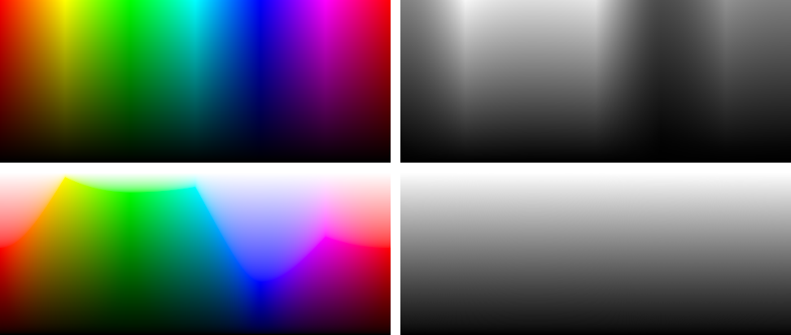

# HSL*

A perceptual colour space built on sRGB that measures lightness as it is perceived (CIE L*).

## Motivation

In an HSV or HSL picker, hue runs across and value or lightness runs up and down. Colours at the same height don't look equally light. HSL* keeps the familiar HSV/HSL hue axis but moves every colour up or down, so that each row of the picker has one perceived lightness. Each pure hue then sits at its own lightness: yellow near the top, blue near the bottom.



*Top: HSV at full saturation, and the same plane converted to grey. Bottom: HSL* at full saturation, and its grey conversion: every row is one even grey.*

## The HSL* colour space

A colour has three components, like HSL:

- `h`: hue, 0–360
- `s`: saturation, 0–1. 1 is the most vivid sRGB colour of that hue and lightness, 0 the grey of the same lightness.
- `l`: perceived lightness, CIE L*, 0–100

### From HSL* to sRGB

All mixing happens in linear light, where luminance is a weighted sum of the channels: Y = 0.2126 R + 0.7152 G + 0.0722 B.

1. **Pure hue:** p is the HSV colour (h, 1, 1), linearised. Its luminance is Y<sub>p</sub>.
2. **Target luminance:** Y follows from L* by the CIE formula: Y = ((L* + 16) / 116)³, or L* / 903.3 for L* ≤ 8.
3. **Most vivid colour at that luminance:**
   - below the pure hue's own lightness (Y ≤ Y<sub>p</sub>), darken it: v = (Y / Y<sub>p</sub>) · p
   - above it, mix it with white: v = p + t · (1 − p), with t = (Y − Y<sub>p</sub>) / (1 − Y<sub>p</sub>)
4. **Saturation:** mix with the grey of the same luminance: c = s · v + (1 − s) · Y
5. **Output:** encode c with the sRGB transfer function.

Every step keeps the luminance at exactly Y, so every colour in a row has the same L*.

### Gamut and inverse

Every (h, s, l) in range gives a colour inside sRGB, and every sRGB colour maps back to exactly one (h, s, l). Greys have no defined hue. s = 1 is the edge of the sRGB gamut: below the pure hue one channel is 0, above it one channel is 1.

The inverse is closed form as well. L* comes from the luminance. The hue comes from the channels normalised to the range 0–1, which removes the mixing with grey and black or white. The saturation is the ratio of the colour's channel range to that of the most vivid colour, which is Y / Y<sub>p</sub> below the pure hue and (1 − Y) / (1 − Y<sub>p</sub>) above it.

## HCY, Okhsl and HSL*

The idea isn't new. HSL* is a close relative of HCY (hue, chroma, luma) by Kuzma Shapran, published by [Chilliant](https://www.chilliant.com/rgb2hsv.html), and pursues the same goal as [Okhsl](https://bottosson.github.io/posts/colorpicker/) by Björn Ottosson.

| | HCY | Okhsl | HSL* |
|---|---|---|---|
| Built on | RGB, usually gamma-encoded | OKLab | sRGB in linear light |
| Lightness | Luma, Rec. 601 weights | OKLab lightness, close to CIE L* | Exact CIE L* |
| Hue | HSV hue | OKLab hue | HSV hue, optionally re-spaced to even OKLab steps |
| Rows of equal lightness | Approximate, up to about 23 L* apart | Close | Exact |
| Hue of tints and shades | Can drift | Stays perceptually constant | Can drift |
| Maths | A few multiplications | Cube roots, approximated gamut | Closed form, exactly invertible |

When to choose which colour space:

- **HCY** is the right choice when speed counts, for example in pixel shaders.
- **Okhsl** is the right choice when hue should look as constant as possible across tints and shades.
- **HSL\*** is the right choice when equal lightness has to hold exactly: each row converts to one grey, as in grayscale conversion and black-and-white printing.

## Library

`picker/src/hsl-star.js` is a dependency-free ES module. Import it as a namespace, so every call says where it comes from:

```js
import * as hslStar from './src/hsl-star.js';

hslStar.toHex(hslStar.toRgb({ h: 18, l: 62, s: 0.9 }));    // '#f7694f'
hslStar.fromRgb(hslStar.parseColor('#0000ff'));           // { h: 240, l: 32.3, s: 1 }
hslStar.toRgb({ h: 120, l: 50, s: 1 }, { hue: 'oklab' }); // perceptual hue axis
```

`toRgb` and `fromRgb` work with gamma-encoded sRGB channels in [0, 1], `toLinear` and `fromLinear` with linear light. To render a whole plane, compute `hueBasis(h)` once per column and call `basisToLinear` per pixel.

## Colour picker

Start a local server from the `picker` folder, then go to http://localhost:8000:

```sh
cd picker && npm run serve
```

Run the tests with `npm test` in the same folder (Node 18 or later).

## Known limits

- sRGB only. Display P3 or print would need their own gamut.
- CIE L* doesn't model the Helmholtz–Kohlrausch effect: very saturated reds, magentas and blues look slightly lighter than a grey with the same L*.
- Tints of a hue can drift slightly in perceived hue (blue towards lavender), because the hue is held constant in RGB terms, not perceptually.

## References

- [Chilliant: RGB to HSV/HSL/HCY](https://www.chilliant.com/rgb2hsv.html): HCY, the closest relative.
- [Björn Ottosson: Okhsv and Okhsl](https://bottosson.github.io/posts/colorpicker/) (2021): the same principle on OKLab.
- [HSLuv](https://hsluv.org/math): saturation as a share of the maximum sRGB chroma, built on CIELUV.
- [KDE's HCY](https://phabricator.kde.org/D27017) and [Krita's HSY′ selector](https://docs.krita.org/reference_manual/dockers/advanced_color_selector.html): HCY-like models in linear RGB.
