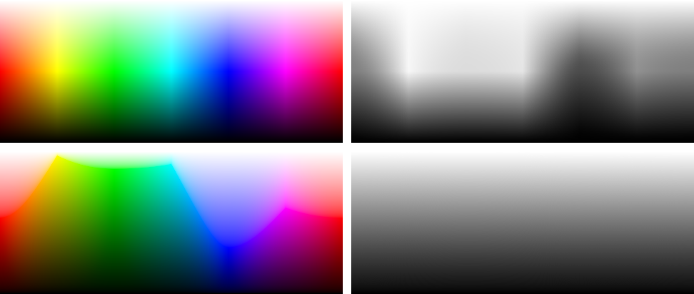

# HSL*

A simple colour space built on sRGB with perceptual lightness and perceptually spaced hue. 

Try the [colour picker](https://domizai.github.io/hsl-star/). 

## Motivation

In an HSL picker, hues at the same height don't look equally light, and hue steps are also not perceptually uniform. The HSL* colour space improves upon HSL by addressing perceptual inconsistencies in lightness and hue. It offers:

- **Consistent lightness.** All colours in a row of the picker share the same lightness, whatever their hue or saturation, and convert to the same grey.

- **Perceptually spaced hue.** Hues are spaced according to OKLab, so equal steps in h look roughly equal in perceived hue. 

- **Intuitive saturation.** Saturation s runs from the neutral grey of that lightness to the edge of the sRGB gamut. Every HSL* coordinate in range is a real sRGB colour, without clipping.

- **Invertible.** HSL* and sRGB convert into each other in closed form. Every sRGB colour has exactly one coordinate, and the conversion back is exact (greys have no hue).

The top row shows HSL at full saturation and its conversion to grey, while the bottom row shows HSL* at full saturation and its conversion to grey.

## Library

Currently there is only a JavaScript implementation. See the [`js`](js/README.md) folder for details.

## Implementation 

HSL* replaces the lightness of HSL with CIE L*, defines saturation relative to the sRGB gamut at a given hue and lightness, and spaces its hue by OKLab. 

- $h$: hue, HSV re-spaced by OKLab [0–360]
- $l$: CIE L* lightness [0–100]
- $s$: sRGB gamut-relative saturation [0–1]

### Luminance and lightness

#### From RGB

Each gamma-encoded sRGB channel C′ is first linearised by using the standard sRGB transfer function:

$$
C = \begin{cases} C' / 12.92 & C' \le 0.04045 \\ \left(\dfrac{C' + 0.055}{1.055}\right)^{2.4} & \text{otherwise} \end{cases}
$$

The relative luminance Y is then the weighted sum of the linear channels, with the Rec. 709 weights of sRGB.

$$
Y = 0.2126\,R + 0.7152\,G + 0.0722\,B
$$

#### From L*

The luminance a given L* needs comes from the inverse of the CIE lightness formula, with $κ$ = 24389/27 ≈ 903.3.

$$
Y = \begin{cases} \left(\dfrac{L^* + 16}{116}\right)^3 & L^* > 8 \\ L^* / \kappa & \text{otherwise} \end{cases}
$$

The other way round, with $ε$ = 216/24389 ≈ 0.008856, gives L* from Y.

$$
L^* = \begin{cases} 116\,\sqrt[3]{Y} - 16 & Y > \varepsilon \\ \kappa\,Y & \text{otherwise} \end{cases}
$$

### From HSL* to sRGB

All mixing happens in linear light, where luminance is a weighted sum of the channels with weights that add up to 1. So scaling a colour scales its luminance, and mixing two colours mixes their luminances in the same proportion. That's what keeps every step below at exactly Y. Vectors are linear RGB, and Y on its own stands for the grey (Y, Y, Y).

1. **Pure colour.** The hue h is turned into an HSV hue, see [Limitations](#limitations). The pure colour of that hue, HSV (h, 1, 1), linearised, is p. Its luminance is Yp, the luminance at which that hue is most vivid.

2. **Target luminance.** Y follows from L*, as above.

3. **Most vivid colour at that luminance.** Below the pure colour, darken it. Above it, mix it with white.

   $$
   v = \begin{cases} \dfrac{Y}{Y_p}\,p & Y \le Y_p \\ (1 - t)\,p + t & Y > Y_p, \quad t = \dfrac{Y - Y_p}{1 - Y_p} \end{cases}
   $$

   v has luminance Y in both cases, and it lies on the edge of the sRGB gamut. Below Yp one channel is 0, above it one channel is 1.

4. **Saturation.** Mix with the grey of the same luminance.

   $$
   c = s\,v + (1 - s)\,Y
   $$

   The luminance stays Y.

5. **Output.** Encode each channel of c with the sRGB transfer function.

   $$
   C' = \begin{cases} 12.92\,C & C \le 0.0031308 \\ 1.055\,C^{1/2.4} - 0.055 & \text{otherwise} \end{cases}
   $$

### From sRGB to HSL*

1. **Linear light.** Linearise the channels, giving c.

2. **Lightness.** Y = 0.2126 R + 0.7152 G + 0.0722 B, and L* from Y, as above.

3. **Channel range.** With m = min(c) and M = max(c), the range is r = M − m. If r = 0, the colour is a grey, with s = 0 and an undefined hue (0).

4. **Hue.** In the forward direction, c is a scaled pure colour plus a grey part. Removing the grey part and the scaling gives the pure colour back.

   $$
   p = \frac{c - m}{r}
   $$

   Encoded, p is an HSV colour with S = V = 1, and its HSV hue is the hue, converted to the hue axis in use.

5. **Saturation.** The most vivid colour of that hue and luminance has this channel range.

   $$
   r_{\max} = \begin{cases} Y / Y_p & Y \le Y_p \\ (1 - Y) / (1 - Y_p) & Y > Y_p \end{cases}
   $$

   Mixing with grey scales the range by s, so s is the ratio of the two.

   $$
   s = \frac{r}{r_{\max}}
   $$

Each step undoes one step of the forward direction, in closed form, without iteration.

## Limitations

- **Saturation isn't perceptually uniform.** It's a share of what sRGB can show at that hue and lightness, not a measure of colourfulness. At L* 40, a fully saturated blue is more than twice as colourful as a fully saturated yellow, at L* 80 the other way round.

- **Hue is only roughly even.** By default h is the HSV hue re-spaced by OKLab, so equal steps look roughly equal. This only reorders the hues, while the colours are still built in RGB, so tints and shades can drift slightly in perceived hue, most of all in the blues. Okhsl avoids this by building its colours in OKLab. HSL* is the deliberately simpler alternative, with a straightforward RGB construction and exact lightness. The plain HSV hue is available as an option.

- **L\* has known limits.** It doesn't model the Helmholtz–Kohlrausch effect, so very saturated reds, magentas and blues look slightly lighter than a grey with the same L*.

- **sRGB only.** Display P3 or print would need their own gamut.

## HSLuv, Okhsl and HSL*

All three give an HSL-like interface with perceptually meaningful lightness and saturation limited to the sRGB gamut. They differ in where hue and saturation come from, and how much work the gamut boundary takes.

| | HSLuv | Okhsl | HSL* |
|---|---|---|---|
| Built on | CIELUV | OKLab | sRGB in linear light |
| Lightness | CIE L* | OKLab lightness with a toe function, close to CIE L* | CIE L* |
| Rows of equal lightness | Exact | Close | Exact |
| Hue | CIELUV hue angle | OKLab hue | HSV hue, spaced by OKLab |
| Hue of tints and shades | Constant in CIELUV | Constant in OKLab | Can drift slightly |
| Saturation | CIELUV chroma as a share of the most the gamut allows | Chroma, interpolated through fitted values to behave evenly | Linear mix between grey and the most vivid sRGB colour |
| Gamut boundary | Ray intersected with six lines per lightness | Approximated with fitted functions | Built into the construction |

**HSLuv** ([hsluv.org](https://www.hsluv.org/math/)) has the same lightness as HSL* and both use CIE L*, so both give rows of exactly equal lightness. But HSLuv defines hue, lightness and chroma in the device-independent CIELUV, and only then limits the result to sRGB. Saturation is the chroma as a share of the maximum at that lightness and hue. That keeps the hue constant through tints and shades, but every conversion goes through XYZ and CIELUV.

HSL* skips both and builds colours directly in RGB, where the gamut boundary is simply one channel at 0 or 1. Its saturation is therefore not chroma, and not designed to be perceptually uniform. That's the price of the simplicity, and a deliberate choice so that the construction is easy to implement and to invert exactly.

**Okhsl** ([Björn Ottosson](https://bottosson.github.io/posts/colorpicker/)) uses OKLab for lightness, hue and saturation. Its lightness is OKLab's, adjusted to come close to CIE L*, so rows are close to equally light but not exact. It also only approximates the sRGB gamut boundary. Okhsl tries harder than HSL* to make hue and saturation perceptually consistent.

## References

- [HSLuv: math](https://www.hsluv.org/math/), HSL-like coordinates on CIELUV, saturation as a share of the maximum sRGB chroma.
- [Björn Ottosson: Okhsv and Okhsl](https://bottosson.github.io/posts/colorpicker/) (2021), HSL-like coordinates on OKLab.
- [Björn Ottosson: A perceptual color space for image processing](https://bottosson.github.io/posts/oklab/) (2020), OKLab, whose hue spaces the HSL* hue axis.
- [W3C: WCAG 2.2](https://www.w3.org/TR/WCAG22/), relative luminance and contrast ratio, with the same weights and transfer function as above.
