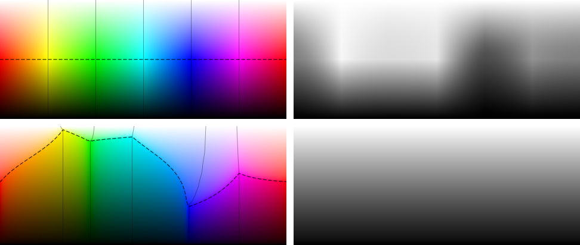

# HSL*

A simple color space built on sRGB, with perceptual lightness, hue and saturation. Every combination of hue, saturation and L* is a valid sRGB color, nothing gets clipped or falls out of gamut.

Try it [here](https://domizai.github.io/hsl-star/), with a color picker, palettes and a contrast checker.

# Motivation

In an HSL picker, hues at the same height don't look equally light, and hue steps are also not perceptually uniform. The HSL* color space improves upon HSL by addressing perceptual inconsistencies in lightness, hue and saturation. It offers:

- **Consistent lightness.** All colors in a row of the picker share the same lightness, whatever their hue or saturation, and convert to the same grey.

- **Perceptually spaced hue.** Hues are spaced according to OKLab, so equal steps in h look roughly equal in perceived hue, and tints, shades and lower saturations keep the OKLab hue of their pure color. 

- **Even saturation.** Saturation s runs from the neutral grey of that lightness to the edge of the sRGB gamut. Near grey, hues that would stand out are toned down, so the same s looks about equally colorful across hues. Every HSL* coordinate in range is a real sRGB color, without clipping.

- **Invertible.** HSL* and sRGB convert into each other directly. Everything is closed form except three tables: the OKLab hue axis, the hue shift that keeps it for tints and shades, and the reference chroma of the saturation correction. Every sRGB color has exactly one coordinate, and the conversion back is exact.



HSL in the top row, HSL* in the bottom row, each at full saturation and converted to grey.

# Implementations

Currently there is only a [JavaScript](js/README.md) and a [GLSL](glsl/README.md) implementation.

# The HSL* color space 

HSL* replaces the lightness of HSL with CIE L*, defines saturation relative to the sRGB gamut at a given hue and lightness, evened out near grey, and spaces its hue by OKLab. 

- $h$: hue, HSV re-spaced by OKLab, kept by tints and shades [0–360]
- $l$: CIE L* lightness [0–100]
- $s$: sRGB gamut-relative saturation, evened out near grey [0–1]

## The hue axis

The hue h is the HSV hue, re-spaced so that equal steps of h are roughly equal steps of OKLab hue. The re-spacing H maps an HSV hue x to h.

1. Take the pure color HSV (x, 1, 1), linearise it and convert it to OKLab. Its hue angle is θ(x) = atan2(b, a).
2. Unwrap θ so it runs on without jumps, starting at 0 for red.
3. Let every HSV degree advance H by at least 0.25°. OKLab sees the pure blues between about HSV 222° and 242° as nearly one hue, and between 232° and 240° θ even runs slightly backwards. Without this, H couldn't be inverted.
4. Scale H so a full turn is 360°.

H has no closed form, so the implementations tabulate it and interpolate linearly. HSL* to sRGB uses the inverse H⁻¹(h) to find the HSV hue, and sRGB to HSL* uses H. On the HSV hue axis, H does nothing.

## The hue shift

On the OKLab axis, h stands for the OKLab hue of its pure color, and its tints, shades and lower saturations keep it. Mixing in white or grey would otherwise move the OKLab hue, by up to 12° in the reds and 22° in the blues, so light blues would drift towards lavender and light reds towards pink (the Abney effect). So before the color is built, its HSV hue x₀ = H⁻¹(h) is shifted to x = D(x₀, L*, s), the HSV hue whose color at this lightness and saturation has the pure color's OKLab hue. Pure colors don't move, so h + 180° is still the opposite hue. On the HSV hue axis, D does nothing.

1. **Anchors.** Every 2.5° of HSV hue, at white shares w = 0, 0.02, 0.05, 0.1, 0.25, 0.5, 0.75, 0.98 and saturations s = 0.1, 0.25, 0.5, 0.75, 1, the shift is measured directly: the HSV hue at which the anchor's color has its pure color's OKLab hue. The white shares lie closest together near 0, because the first bit of white moves the hue the most, most of all in the blues.

2. **White share.** An anchor counts w from the lightest pure color among it and its two neighbours, with luminance Y<sub>ref</sub>. Along 2.5° of hue the pure luminance only rises or falls, so every pure color and its shades have w = 0 at both anchors around them, where s = 1 has no shift.

   ```math
   w = \max\!\left(0, \frac{Y - Y_{ref}}{1 - Y_{ref}}\right)
   ```

3. **Between anchors.** Bilinear in w and s, linear from one anchor to the next. At a given L* and s every anchor's shift is a number, so x is piecewise linear in x₀, and the inverse finds x₀ from x in one step, exactly.

4. **Order.** For that step to be unique, the shifted anchors must stay in order. Where the blues would need their tints moved past their neighbours', the table holds the shift back, so that every anchor stays at least 0.08° per degree ahead of the one before.

The table isn't fitted. `scripts/tables.js` makes it, and `npm run sync` writes it into both implementations:

- **Measuring.** For each anchor, white share and saturation, it builds the color at HSV hues within 60° of the anchor and looks for where its OKLab hue crosses the pure color's, in half-degree steps. The crossing nearest the anchor is then narrowed down by bisection. The pure colors' own cells (w = 0, s = 1) are set to 0.
- **Ordering.** On a grid of L* and s, wherever two neighbouring shifted anchors come too close, the earlier one is moved down and the later one up, by the smallest change that restores the gap. The pure colors' cells stay. This is repeated until no gap is short any more.
- **Together with the saturation correction.** The reference chroma of [the saturation correction](#the-saturation-correction) is measured at s = 1, where the shift moves the tints, and the shift below s = 1 is measured with the saturation correction. So the two tables are made in turn until neither changes, which takes two or three rounds.

Weighted by chroma, the OKLab hue of tints and lower saturations stays within 0.3° of the pure color's on average, at worst about 4° in the blues. Without the shift it's 3.3° and 21.5°.

## The saturation correction

The most vivid colors differ a lot in colorfulness between hues. At L* 40, the most vivid blue has several times the OKLab chroma of the most vivid yellow, so at equal low saturation the blue would look far more saturated. HSL* tones down the hues that stand out, near grey, and leaves the others as they are.

1. **Colorfulness.** C<sub>max</sub> is the OKLab chroma of v, the most vivid color of that hue and lightness (step 4 of [HSL* to sRGB](#hsl-to-srgb)).

2. **Reference.** C<sub>0</sub>(L*) is the median of C<sub>max</sub> over 72 hues 5° apart on the OKLab hue axis. The implementations tabulate it at every half L* and interpolate linearly. Both hue axes use the same table, so the same hue, lightness and saturation give the same color on either.

3. **Strength.** A hue at or below the median keeps k = 1. Above it, with q = C<sub>max</sub> / C<sub>0</sub>, the strength grows with how far the hue stands out. The smoothstep f fades it in over the first quarter above the median, so neighbouring hues don't jump.

   ```math
   k = 1 + 0.6\,f\,\left(q^{1.5} - 1\right), \quad f = x^2\,(3 - 2x), \quad x = \min\!\left(1, \frac{q - 1}{0.25}\right)
   ```

4. **Share of the vivid color.** Saturation s gives the share t of v in the mix with grey.

   ```math
   t = \frac{s}{k + (1 - k)\,s}
   ```

   As k ≥ 1, t ≤ s, so no color gets more colorful than without the correction. t rises steadily with s, and s = 0 and s = 1 stay as they are. k depends only on hue and lightness, which both directions know, so the correction is undone exactly.

The strength 0.6 and the exponent 1.5 are fitted against Okhsl, whose saturation was designed to look evenly colorful near grey.

## HSL* to sRGB

All mixing happens in linear light, where luminance is a weighted sum of the channels with weights that add up to 1. So scaling a color scales its luminance, and mixing two colors mixes their luminances in the same proportion. That's what keeps every step below at exactly Y. Vectors are linear RGB, and Y on its own stands for the grey (Y, Y, Y).

1. **Hue.** The HSV hue of h is x₀ = H⁻¹(h), from [the hue axis](#the-hue-axis). On the OKLab axis it's then shifted for this lightness and saturation, x = D(x₀, L*, s), as in [the hue shift](#the-hue-shift); on the HSV axis, x = x₀.

2. **Pure color.** The pure color of that hue is HSV(x, 1, 1). Each of its gamma-encoded channels C′ is linearised with the sRGB transfer function, which gives p.

   ```math
   C = \begin{cases} C' / 12.92 & C' \le 0.04045 \\ \left(\dfrac{C' + 0.055}{1.055}\right)^{2.4} & \text{otherwise} \end{cases}
   ```

   The luminance of p is the weighted sum of its linear channels, with the Rec. 709 weights of sRGB. Y<sub>p</sub> is the luminance at which that hue is most vivid.

   ```math
   Y_p = 0.2126\,p_R + 0.7152\,p_G + 0.0722\,p_B
   ```

3. **Target luminance.** The luminance the color must have follows from L*, by the inverse of the CIE lightness formula, with κ = 24389/27 ≈ 903.3.

   ```math
   Y = \begin{cases} \left(\dfrac{L^* + 16}{116}\right)^3 & L^* > 8 \\ L^* / \kappa & \text{otherwise} \end{cases}
   ```

4. **Most vivid color at that luminance.** Below the pure color, darken it. Above it, mix it with white.

   ```math
   v = \begin{cases} \dfrac{Y}{Y_p}\,p & Y \le Y_p \\ (1 - w)\,p + w & Y > Y_p, \quad w = \dfrac{Y - Y_p}{1 - Y_p} \end{cases}
   ```

   v has luminance Y in both cases, and it lies on the edge of the sRGB gamut. Below Y<sub>p</sub> one channel is 0, above it one channel is 1.

5. **Saturation.** Turn s into the share t of the vivid color, with the strength k of that hue and lightness, as in [the saturation correction](#the-saturation-correction). Then mix v with the grey of the same luminance.

   ```math
   t = \frac{s}{k + (1 - k)\,s}, \qquad c = t\,v + (1 - t)\,Y
   ```

   The luminance stays Y.

6. **Output.** Encode each channel of c with the sRGB transfer function, the inverse of the one in step 2.

   ```math
   C' = \begin{cases} 12.92\,C & C \le 0.0031308 \\ 1.055\,C^{1/2.4} - 0.055 & \text{otherwise} \end{cases}
   ```

## sRGB to HSL*

1. **Linear light.** Linearise the channels as in step 2 above, giving c.

2. **Lightness.** The luminance of c is the weighted sum of its channels, as in step 2 above, and L* follows from it by the CIE lightness formula, with ε = 216/24389 ≈ 0.008856.

   ```math
   Y = 0.2126\,c_R + 0.7152\,c_G + 0.0722\,c_B
   ```

   ```math
   L^* = \begin{cases} 116\,\sqrt[3]{Y} - 16 & Y > \varepsilon \\ \kappa\,Y & \text{otherwise} \end{cases}
   ```

3. **Channel range.** With m = min(c) and M = max(c), the range is r = M − m. If r = 0, the color is a grey, with s = 0 and an undefined hue (0).

4. **Pure color.** In the forward direction, c is a scaled pure color plus a grey part. Removing the grey part and the scaling gives the pure color back, in linear light.

   ```math
   p = \frac{c - m}{r}
   ```

   Encoded, p is an HSV color with S = V = 1, and x is its HSV hue. Its luminance is Y<sub>p</sub>, the weighted sum of its channels as before.

   ```math
   Y_p = 0.2126\,p_R + 0.7152\,p_G + 0.0722\,p_B
   ```

5. **Saturation.** The most vivid color of that hue and luminance has this channel range.

   ```math
   r_{\max} = \begin{cases} Y / Y_p & Y \le Y_p \\ (1 - Y) / (1 - Y_p) & Y > Y_p \end{cases}
   ```

   Mixing with grey scales the range by the share t, so t is the ratio of the two. Undoing the saturation correction with the strength k of that hue and lightness, from v as in step 4 of [HSL* to sRGB](#hsl-to-srgb), gives s.

   ```math
   t = \frac{r}{r_{\max}}, \qquad s = \frac{k\,t}{1 - (1 - k)\,t}
   ```

6. **Hue.** On the HSV axis, h = x. On the OKLab axis, undo the hue shift with this L* and s first, x₀ = D⁻¹(x, L*, s), as in [the hue shift](#the-hue-shift), then h = H(x₀), from [the hue axis](#the-hue-axis).

# Limitations

- **Saturation is only roughly even.** The correction evens out colorfulness near grey by toning down the most colorful hues, measured against the median hue, but it never boosts the weak ones. Full saturation doesn't change. s = 1 is still the edge of the sRGB gamut, and at L* 40 a fully saturated blue is more than twice as colorful as a fully saturated yellow, at L* 80 the other way round.

- **Hue is only roughly even.** By default h is the HSV hue re-spaced by OKLab, so equal steps look roughly equal, and the hue shift keeps the OKLab hue for tints, shades and lower saturations, to within a few tenths of a degree on average. In the blues it's held back to keep the conversion invertible, so blues can still drift by up to about 4°. And OKLab hue isn't perceived hue in every case. The plain HSV hue is available as an option, without the shift.

- **L\* has known limits.** It doesn't model the Helmholtz–Kohlrausch effect, so very saturated reds, magentas and blues look slightly lighter than a grey with the same L*.

# HSLuv, Okhsl and HSL*

All three give an HSL-like interface with perceptually meaningful lightness and saturation limited to the sRGB gamut. They differ in where hue and saturation come from, and how much work the gamut boundary takes.

HSL, Okhsl and HSL* side by side, in figures and measurements, are in [COMPARISON.md](COMPARISON.md).

| | HSLuv | Okhsl | HSL* |
|---|---|---|---|
| Built on | CIELUV | OKLab | sRGB in linear light |
| Lightness | CIE L* | OKLab lightness with a toe function, close to CIE L* | CIE L* |
| Rows of equal lightness | Exact | Close | Exact |
| Hue | CIELUV hue angle | OKLab hue | HSV hue, spaced by OKLab |
| Hue of tints and shades | Constant in CIELUV | Constant in OKLab | Kept in OKLab within a few tenths of a degree, up to about 4° in the blues |
| Saturation | CIELUV chroma as a share of the most the gamut allows | Chroma, interpolated through fitted values to behave evenly | Linear mix between grey and the most vivid sRGB color, toned down near grey for the most colorful hues |
| Gamut boundary | Ray intersected with six lines per lightness | Approximated with fitted functions | Built into the construction |
| Round trip | Exact, up to rounding (about 10⁻¹³) | Close, within about 10⁻⁷ | Exact, up to rounding (about 10⁻¹⁴) |

**HSLuv** ([hsluv.org](https://www.hsluv.org/math/)) has the same lightness as HSL* and both use CIE L*, so both give rows of exactly equal lightness. But HSLuv defines hue, lightness and chroma in the device-independent CIELUV, and only then limits the result to sRGB. Saturation is the chroma as a share of the maximum at that lightness and hue. That keeps the hue constant through tints and shades, but every conversion goes through XYZ and CIELUV.

HSL* skips both and builds colors directly in RGB, where the gamut boundary is simply one channel at 0 or 1. Its saturation is therefore not chroma. A closed-form correction near grey evens out how colorful the hues look, but saturation stays a share of the gamut, not a measure of colorfulness. That's the price of the simplicity, and a deliberate choice so that the construction is easy to implement and to invert exactly.

**Okhsl** ([Björn Ottosson](https://bottosson.github.io/posts/colorpicker/)) uses OKLab for lightness, hue and saturation. Its lightness is OKLab's, adjusted to come close to CIE L*, so rows are close to equally light but not exact. It also only approximates the sRGB gamut boundary. Okhsl tries harder than HSL* to make hue and saturation perceptually consistent, and HSL*'s saturation correction is fitted against it.

The two start from opposite ends. Okhsl builds its colors in OKLab, so hue and colorfulness are perceptual from the start, and approximates the sRGB gamut boundary with fitted polynomials and a Newton-type step. HSL* builds them in sRGB, so the gamut boundary and exact L* come for free, and adds each perceptual property as a correction with its own table, for the OKLab hue axis, the hue shift and the saturation correction. HSL* also undoes itself exactly. What's left of a round trip, about 10⁻¹⁴, is the rounding of 64-bit floating point. So does HSLuv, to about 10⁻¹³. Okhsl's round trip is off by up to 2.6·10⁻⁷ per channel, inherited from OKLab, whose two published matrices aren't exact inverses of each other (measured with ports of the reference implementations, in linear sRGB). That's far below an 8-bit step, but not exact.

# References

- [HSLuv: math](https://www.hsluv.org/math/), HSL-like coordinates on CIELUV, saturation as a share of the maximum sRGB chroma.
- [Björn Ottosson: Okhsv and Okhsl](https://bottosson.github.io/posts/colorpicker/) (2021), HSL-like coordinates on OKLab.
- [Björn Ottosson: A perceptual color space for image processing](https://bottosson.github.io/posts/oklab/) (2020), OKLab, whose hue spaces the HSL* hue axis.
- [W3C: WCAG 2.2](https://www.w3.org/TR/WCAG22/), relative luminance and contrast ratio, with the same weights and transfer function as above.
